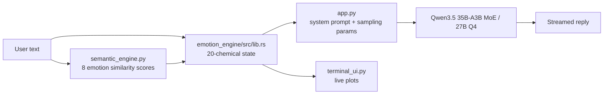

# Kanfai: File-by-File Guide for Researchers

This document explains why each file in the repository exists, how it works internally, and what it is used for. It reflects the code as it currently stands, including the recent improvements to the engine, the semantic analyzer, the UI and the training script.

## 1. Big Picture

Kanfai is a **neuro-symbolic conversational agent**. Its "mood" is not prompted directly. It comes from a simulated neurochemical state that evolves turn by turn, and that state then conditions the language model in two ways.



1. **Prompt conditioning:** the chemical levels are written into the system prompt as text.
2. **Sampling conditioning:** the chemical levels change `temperature`, `top_p` and `max_new_tokens`.

Each turn runs these steps in order:

1. The user input is scored against 8 emotion anchors (Python, `torch`).
2. The scores and a lexical keyword scan update the 20 chemicals (Rust).
3. The new state is plotted, turned into a prompt and sampling parameters, and sent to the LLM.

---

## 2. Repository Map

| Path | Role | Used at runtime? |
|---|---|---|
| `app.py` | Main entry point and chat loop | Yes |
| `semantic_engine.py` | Embedding-based emotion scoring | Yes (imported by `app.py`) |
| `emotion_engine/src/lib.rs` | Neurochemical simulation in Rust | Yes (compiled to a Python module) |
| `emotion_engine/Cargo.toml` | Rust crate config | Build time |
| `emotion_engine/pyproject.toml` | `maturin` packaging config | Build time |
| `terminal_ui.py` | Terminal I/O and live plots | Yes (imported by `app.py`) |
| `kanfai_colab.ipynb` | Google Colab interactive notebook for A100 | Colab runtime |
| `train.py` | LoRA fine-tuning of an optional small model | Offline, optional |
| `main.py` | Placeholder (a single comment) | No |
| `requirements.txt` | Python dependencies | Install time |
| `README.md` | User-facing intro and setup | Docs |
| `ARCHITECTURE.md` | This file | Docs |
| `LICENSE` | Licensing terms | n/a |
| `.gitignore`, `.idea/` | Git ignore rules and JetBrains IDE settings | n/a |

---

## 3. `app.py`: the orchestrator

**Why it exists:** it is the single place where the three subsystems (semantic scoring, chemistry, LLM) are wired together. Run it with `python app.py`.

**How it works:**

1. **Startup**
   - Imports the compiled `emotion_engine` module. If it is missing, it prints build instructions and exits.
   - Creates `state = emotion_engine.EmotionState()`.
   - Loads the tokenizer and model via `load_kanfai_model()` using `device_map="auto"` and 4-bit NF4 quantization (`BitsAndBytesConfig`) when CUDA is available:
     - Default MoE model (`USE_MOE_MODEL = True`): `huihui-ai/Huihui-Qwen3.5-35B-A3B-abliterated` (35B total parameters, 3B active per token).
     - Dense 27B model (`USE_MOE_MODEL = False`): `huihui-ai/Huihui-Qwen3.5-27B-abliterated`.
     - If `USE_REDDIT_BRAIN = True` and a local `kanfai-360m` folder exists, that model is used instead (the output of `train.py`).
     - Automatically handles both `AutoModelForCausalLM` and `AutoModelForImageTextToText` registrations for the `qwen3_5` / `qwen3_5_moe` architectures, and passes `enable_thinking=False` to `apply_chat_template` so `<think>...</think>` blocks are suppressed during real-time roleplay.
   - Builds `TerminalUI` and `SemanticAnalyzer`.

2. **Per-turn loop**
   - Slash commands:
     - `/exit`, `/quit`, `/q` quit.
     - `/semantic` toggles the semantic engine.
     - `/clear` wipes short-term chat memory.
   - **Stimulation**
     - Semantic mode on: `analyzer.analyze(text)` gives 8 cosine similarities, which are passed to `state.stimulate_with_semantics(text, scores)`.
     - Semantic mode off: `state.stimulate(text)` uses lexical matching only.
   - `state.get_state()` returns a `{chemical: float}` dict, which is plotted by the UI.
   - **`get_llm_params(state)`** maps chemistry to sampling settings using smooth sigmoids (no hard thresholds):
     - `temperature` rises with net arousal. Arousal is `0.45·adrenaline + 0.35·glutamate + 0.20·histamine − 0.35·GABA − 0.15·glycine`.
     - `max_new_tokens` falls with fatigue. It is driven by `drive = 0.65·dopamine + 0.35·DHEA` against `fatigue = 0.6·adenosine + 0.4·melatonin`.
     - `top_p` narrows when focus is high. Focus is `0.55·norepinephrine + 0.45·acetylcholine`.
   - **`get_system_prompt(state)`** builds a static persona prompt (`STATIC_PERSONA_PROMPT`) plus all 20 chemical values grouped into four categories.
   - The last 6 messages (`chat_history`, a `deque`) are included for continuity.
   - Generation runs in a background thread under `torch.inference_mode()`. `TextIteratorStreamer` feeds tokens to the UI as they arrive.

**Research notes:**
- The LLM never "knows" the math. It only sees the numbers in text, so the emotional effect depends on the model's ability to interpret them.
- Sampling parameters are the only hard, non-textual coupling between chemistry and behavior.

---

## 4. `semantic_engine.py`: the embedding-space emotion detector

**Why it exists:** keyword matching misses context. This module scores a sentence against 8 emotion concepts (`anger, joy, focus, sadness, hunger, lazy, motivation, sleep`) cheaply, using only the LLM's input embedding table. No transformer forward pass is run.

**How it works:**

1. **Anchors.** Each emotion is defined by a bag of descriptive words (`anchor_definitions`). Each bag is embedded once at startup into a unit vector.
2. **Anisotropy correction.** Raw token embeddings of causal LMs sit in a narrow cone, so all cosine similarities look alike. The class subtracts the global mean embedding (`self.embedding_mean`, computed over the whole vocabulary) before normalizing. This follows the "all-but-the-top" idea.
3. **Weighted pooling in `get_embedding`.** For user text, tokens are weighted by their centered L2 norm. Then:
   - Stop words (`STOP_WORDS`) are scaled by 0.15.
   - Negation words (`NEGATION_WORDS`) are scaled by 0.10.
   - Content tokens within 2 tokens after a negation get a weight of −0.5. This pushes "not happy" away from the joy anchor.
   - The weighted sum is divided by the sum of absolute weights and L2-normalized.
4. **Scoring in `analyze`.** All 8 anchors are stacked into one `(8, D)` matrix, so scoring is a single matrix product. The result is a `{emotion: cosine}` dict.

**Limitations to keep in mind:**
- Static (non-contextual) embeddings cannot model syntax, sarcasm or word-order effects beyond the crude negation window.
- Anchor bags are hand-written. Results depend on the tokenizer's vocabulary.
- Running the file directly (`python semantic_engine.py`) loads the model and prints scores for a test sentence.

---

## 5. `emotion_engine/`: the biological simulator (Rust + PyO3)

**Why it exists:** the chemistry update runs every turn and involves many small numeric operations. Rust gives a tight, allocation-light implementation exposed to Python through PyO3 and built with `maturin`.

### 5.1 `src/lib.rs`

**State.** `EmotionState` holds `chemicals: [f32; 20]`. The array order is documented at the top of the file and mirrored in `CHEM_NAMES`.

| Constant | Meaning |
|---|---|
| `BASELINES` | Homeostatic resting level for each chemical |
| `DECAY_RATES` | Fraction of the gap to baseline recovered per turn. Fast for adrenaline and glutamate, slow for cortisol, serotonin and oxytocin. It is zero for adenosine and melatonin, which accumulate instead. |
| `SENSITIVITY_MATRIX` | 20×8 matrix **W**. Entry `W[i][j]` says how strongly emotion `j` pushes chemical `i`. |

**Per-turn update.** Each call to `stimulate` or `stimulate_with_semantics` does the following:

1. **`step_homeostasis_and_coupling`**
   - Each chemical relaxes toward its baseline: `c ← c·(1−r) + base·r`.
   - Adenosine (+0.01) and melatonin (+0.005) accumulate, which models sleep pressure.
   - Cross-chemical effects are applied, scaled by how far the source chemical is above baseline:
     - Cortisol suppresses serotonin, oxytocin and DHEA, and raises norepinephrine.
     - GABA inhibits glutamate, adrenaline and norepinephrine.
     - Oxytocin buffers cortisol and adrenaline.
     - Adenosine suppresses dopamine, acetylcholine, glutamate and histamine.
     - Ghrelin and leptin oppose each other, and high ghrelin adds a small cortisol bump ("hangry").
2. **`extract_lexical_activations`**
   - Lowercases the text and tokenizes once on non-alphanumeric characters (apostrophes are kept, so punctuation no longer blocks matches).
   - Builds hash sets of negated and non-negated tokens, using a 2-token look-back window.
   - Counts hits per emotion category. Activation is `1.0 + 0.25·(hits−1)`, capped at 1.5.
   - Negated positive words mildly activate sadness. Negated anger words mildly activate the lazy/calm category.
3. **`stimulate_with_semantics` only**
   - Converts the 8 semantic scores to z-scores across emotions.
   - Keeps only emotions more than 0.65 standard deviations above the mean. Intensity is `min((z−0.65)·0.65, 1.2)`.
   - Blends this with the lexical activation.
4. **`apply_emotion_vector`**
   - Computes `Δc = W · a`, where `a` is the 8-dim activation vector.
   - Applies it with `apply_soft_delta`: increases are scaled by remaining headroom and decreases by current level. Values approach 0 and 1 asymptotically instead of clipping hard.
   - Strong lazy or sleep activation also clears a little adenosine.

**Python API.**

| Method | Behavior |
|---|---|
| `EmotionState()` | New state at baselines |
| `stimulate(text)` | Lexical-only update |
| `stimulate_with_semantics(text, scores_dict)` | Hybrid update |
| `get_state()` | Dict of all 20 chemical levels |

**Research notes:**
- The numbers in `W`, `DECAY_RATES` and the coupling coefficients are **heuristic design choices, not fitted to physiological data**. Treat them as tunable hyperparameters.
- `turn_count` is tracked but currently not used in any output.
- The names are neuroscience-inspired labels, not a pharmacokinetic model.

### 5.2 `Cargo.toml`

Declares the crate `emotion_engine` as a `cdylib` (a shared library Python can import). Its only dependency is `pyo3 0.20` with the `extension-module` feature.

### 5.3 `pyproject.toml`

Tells `maturin` how to package the crate as a Python module (`requires-python >= 3.8`). Build and install it with `maturin develop --release` from the `emotion_engine/` folder. On very new Python versions, set `PYO3_USE_ABI3_FORWARD_COMPATIBILITY=1` first.

---

## 6. `terminal_ui.py`: interface and live biometrics

**Why it exists:** it gives immediate visual feedback on the 20 chemicals, which is useful for debugging and for demos.

**How it works:**

- **Console output** uses `rich` for the banner and the `USER >` prompt. Model tokens are printed as they stream.
- **Plots.** A 2×2 matplotlib figure groups the chemicals into four panels:
  - Excitatory & Drive
  - Inhibitory & Mood
  - Stress & Survival
  - Metabolic & Sleep
- **Efficiency.**
  - All 20 `Line2D` objects, legends and axes are created once in `__init__`.
  - `update_plot` only appends to bounded `deque(maxlen=100)` histories, calls `set_data`, adjusts the x-limits, and calls `draw_idle` and `flush_events`.
  - Plot cost therefore stays constant over long conversations. Only the last 100 turns are shown.

---

## 7. `train.py`: optional fine-tuning pipeline

**Why it exists:** it creates a smaller, Reddit-flavored model (`kanfai-360m`) from `HuggingFaceTB/SmolLM2-360M-Instruct`. It is not required for normal use. It is selected by `USE_REDDIT_BRAIN` in `app.py`.

**How it works:**

1. Loads the base model and applies **LoRA** (`r=8`, `alpha=16`, targeting `q_proj` and `v_proj`).
2. Loads the first 8000 rows of the `go_emotions` dataset.
3. `map_goemotions_to_state` maps the first GoEmotions label into one of a few coarse state descriptions (rage, misery, euphoria, stressed, longing, neutral).
4. `format_prompt` builds a chat sample: a system prompt with that state, a random generic user prompt, and the Reddit text as the assistant reply.
5. **Label masking.** The prompt is tokenized separately from the full sequence. Prompt tokens and padding get label `-100`. Only the assistant response and its EOS token are trained on. `default_data_collator` is used so these labels are not overwritten.
6. Trains for one epoch and saves the adapter and tokenizer to `./kanfai-360m`.

**Research notes:**
- The model is trained on **discrete mood text**, not on the 20-chemical numeric prompt that `app.py` produces at runtime. This is a distribution mismatch if you switch to `kanfai-360m`.
- Only the first label per example is used, so multi-label emotions are collapsed.
- The saved folder contains LoRA weights. Loading it as a full model in `app.py` may require merging the adapter first.

---

## 8. Supporting files

- **`main.py`**: contains only `# nothing to see here lmao`. It is a leftover IDE stub. The real entry point is `app.py`.
- **`requirements.txt`**: `maturin, torch, transformers, matplotlib, numpy, datasets, peft, trl`. `rich` is imported by `terminal_ui.py` but is **not listed**, so install it manually. `trl` and `numpy` are not directly used by the current code.
- **`README.md`**: casual project intro and Windows/PowerShell setup commands.
- **`LICENSE`**: license for the repository.
- **`.gitignore`, `.idea/`**: housekeeping only.

---

## 9. Setup and Reproduction

```bash
pip install -r requirements.txt rich
cd emotion_engine
PYO3_USE_ABI3_FORWARD_COMPATIBILITY=1 maturin develop --release
cd ..
python app.py
```

The first run downloads about 3-4 GB for the Qwen model.

---

## 10. Extension Ideas for Researchers

- **Fit parameters.** Calibrate `W`, `DECAY_RATES` and the coupling terms against human affect ratings instead of hand-tuning them.
- **Better semantic scoring.** Replace static embeddings with a pooled mid-layer hidden state. Compare against a small sentiment classifier.
- **Ablations.** Run with and without the chemistry-to-sampling coupling, and with and without the prompt text, to measure each one's effect on the replies.
- **Logging.** Record `(user_input, scores, state, params, reply)` per turn for offline analysis.
- **Tests.** Add Rust unit tests (convergence to baseline, bounds in [0, 1]) and Python tests for negation handling.
